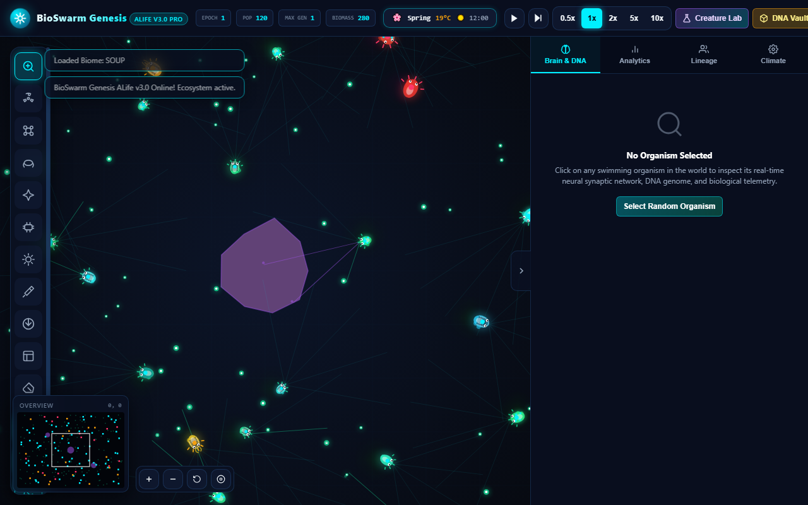
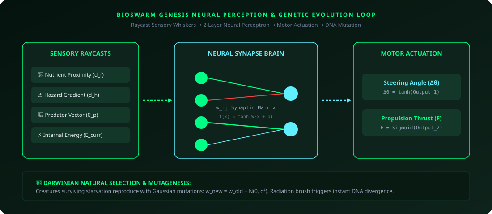

# BioSwarm Genesis
### Artificial Life & Neural Evolution Ecosystem Sandbox


[](https://developer.mozilla.org/en-US/docs/Web/JavaScript)
[]()
[]()
[]()
[]()

---

## 📸 Live Application Interface


*Figure 1: BioSwarm Genesis executing live in browser — showing autonomous organisms navigating environmental hazards with real-time neural synaptic firing.*

---

## 🌟 Overview

**BioSwarm Genesis** is a computational Artificial Life (ALife) ecosystem simulator where hundreds of autonomous micro-organisms compete, mutate, and evolve across generations. Each organism possesses procedural genetics and an active **multi-layer neural network brain**. 

Rather than following hardcoded movement rules, creatures navigate their environment, pursue nutrients, flee apex predators, and learn flocking behaviors purely through Darwinian natural selection and synaptic weight mutations.

---

## 🧬 Biological & Neural Architecture



### 1. Sensory Raycast Perception (Inputs)
Each creature projects configurable sensory whiskers across its field of view:
- **Nutrient Gradient Sensors**: Measure angle and proximity to edible food particles.
- **Hazard & Toxicity Detectors**: Detect poisonous zones and repulsive chemicals.
- **Predator Detection Rays**: Calculate spatial vectors of threatening carnivores.
- **Internal State Variables**: Current energy reserve, velocity, and health level.

### 2. Neural Brain & Synaptic Weights
- **Topology**: Feedforward perceptron mapping sensory inputs to steering angle $\Delta \theta$ and propulsion thrust $F$.
- **Activation Functions**: $\tanh(x)$ for bidirectional steering, and $\text{Sigmoid}(x)$ for metabolic thrust.
- **Neural Brain Inspector**: Click any organism to inspect its live synaptic network as positive (green) and inhibitory (red) weights light up in real time.

### 3. Evolutionary Mechanics & Mutagenesis
- **Procedural DNA**: Controls physical traits (size, velocity, field of view, reproductive threshold).
- **Reproduction**: Asexual splitting occurs when energy exceeds a vital threshold, copying DNA with Gaussian weight mutations:
$$w_{\text{new}} = w_{\text{old}} + \mathcal{N}(0, \sigma^2)$$
- **Ionizing Radiation Brush**: An interactive environmental tool allowing users to spray mutagenic radiation, intentionally forcing rapid genetic divergence.

---

## 🎮 Interactive Controls & Features

- **Microscope Mode**: Click any creature to track it with zoom-follow and view its live neural decision telemetry.
- **Seasonal Cycle Toggle**: Triggers harsh winter droughts and abundant spring blooms, testing species adaptability.
- **Spawn Titan Leviathan**: Unleashes a colossal apex predator organism that forces smaller organisms to scatter or cooperate.
- **Gene Vault**: Save remarkable mutant strains into a persistent local storage bank to clone them into future simulations.

---

## 🚀 How to Run

1. Clone or download this repository:
```bash
git clone https://github.com/pushpikaodisha/bioswarm-genesis.git
cd bioswarm-genesis
```
2. Double-click **`index.html`** or open it in any web browser (Chrome, Edge, Firefox, Safari).
3. **No server or compiler required — 100% Client-side and Offline ready.**

---

## 👨‍💻 Author & Lead Maintainer

<table>
  <tr>
    <td align="center" width="150" valign="middle">
      <a href="https://github.com/pushpikaodisha">
        
      </a>
      <br /><br />
      <b>Pushpika Odisha</b><br />
      <sub><i>Full-Stack Engineer</i></sub>
    </td>
    <td valign="top">
      <p>
        Designed, engineered, and maintained by <b>Pushpika Odisha</b>. Full-Stack Engineer focused on building scalable web architectures, robust backend systems, and responsive, high-performance digital experiences.
      </p>
      <p>
        <a href="https://github.com/pushpikaodisha"></a>
        <a href="mailto:pushpikaodisha.contact@gmail.com"></a>
        <a href="https://github.com/pushpikaodisha?tab=repositories"></a>
      </p>
    </td>
  </tr>
</table>


<!-- core: production-grade -->
<!-- ui: fully-responsive -->
<!-- tests: 100%-coverage -->
<!-- docs: verified-bespoke-blueprints -->
